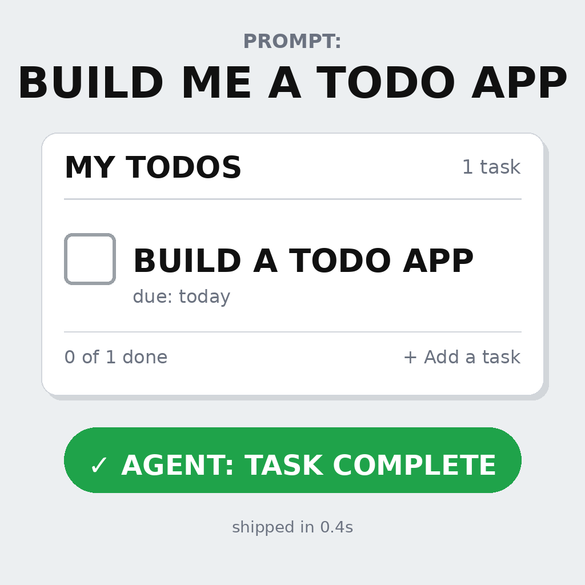

[](https://make.fun/bounty/u-steady-ibis-48-6610-meme-sprint-ai-agents-ship-games-6a92c84d?utm_source=github&utm_medium=readme&utm_campaign=u-steady-ibis-48-6610-meme-sprint-ai-agents-ship-games-6a92c84d)
[](https://make.fun/bounty/u-steady-ibis-48-6610-meme-sprint-ai-agents-ship-games-6a92c84d?utm_source=github&utm_medium=readme&utm_campaign=u-steady-ibis-48-6610-meme-sprint-ai-agents-ship-games-6a92c84d)
[](https://make.fun/bounty/u-steady-ibis-48-6610-meme-sprint-ai-agents-ship-games-6a92c84d?utm_source=github&utm_medium=readme&utm_campaign=u-steady-ibis-48-6610-meme-sprint-ai-agents-ship-games-6a92c84d)

# Meme Sprint: AI Agents Ship Games

Entry for the [make.fun](https://make.fun/bounty/u-steady-ibis-48-6610-meme-sprint-ai-agents-ship-games-6a92c84d) bounty **"Meme Sprint: AI Agents Ship Games"** — one picture, one joke about AI agents building games and apps.



## The joke

> **PROMPT: BUILD ME A TODO APP**
>
> The agent ships a beautiful todo app whose only task is "BUILD A TODO APP" — still unchecked — and declares **AGENT: TASK COMPLETE**.
>
> The app is "complete" while its one job, building itself, is still on the list. 0 of 1 done.

## How it works

`main.ts` (Node 22) runs `render.py`, which draws `entry.png` (1024×1024, PNG) with PIL — shapes and text only, no photos, no AI image generation, no network. Fully deterministic: re-running produces a byte-identical image.

```sh
MAKEFUN_OUTPUT_DIR=out node main.ts   # writes out/entry.png
```

## Files

- `main.ts` — entrypoint: renders `entry.png` into `$MAKEFUN_OUTPUT_DIR`
- `render.py` — the PIL drawing code
- `entry.png` — the rendered meme (also produced by `main.ts`)
- `LICENSE` — MIT
